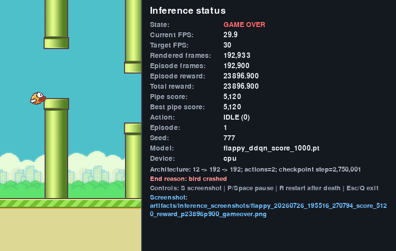

# Flappy Bird — Deep Reinforcement Learning Agent

A Dueling Double DQN with Prioritized Experience Replay that learns to play Flappy Bird
from a 12-feature state vector. The best run I recorded reached a pipe score of
**5,120** in a single uncapped episode.



*The agent's best recorded episode: 5,120 pipes, 192,900 frames, ended by a genuine crash
rather than a score cap. Full provenance in [§10](#10-results).*

**Read [§10.3](#103-a-single-run-is-not-an-average) before quoting any number from this
repository.** 5,120 is the best single episode I observed, not typical performance. The
same agent family averages a few hundred pipes across fresh seeds, and this README tries
hard to keep that distinction visible.

---

## 1. Project Overview

This repository contains everything behind a personal attempt at a Flappy Bird
reinforcement-learning challenge: two training notebooks, the shared model code they
depend on, two inference viewers, and the artefacts of the runs that produced the results
below.

The agent learns entirely from the environment's 12-dimensional feature vector — no pixels,
no lidar. The network is small (89,347 parameters), and **every result here was both
trained and evaluated on CPU** — no GPU was used at any point.

What is here:

- **Two training phases** — an initial run on Kaggle, then a rebuilt local run (v2) that
  fixed two specific instabilities in the first.
- **Shared model code** so training and playback cannot drift apart.
- **Two desktop viewers**, one per checkpoint generation.
- **The evidence** — screenshots, plots, training logs, and the raw JSON of every
  evaluation, including the ones that went badly.

---

## 2. Challenge Background

The challenge was **suggested by Mr Abdullah**, one of the instructors during the
reinforcement-learning weeks of the **KAUST Academy AI Summer School**.

There was **no official leaderboard**, no submission process, and no formal scoring. It was
an open invitation to go and try the problem.

I gave it an honest attempt. The goal was to actually apply what was covered during the RL
weeks rather than to produce a number, and this repository reflects that: the failed
evaluations and the weak episodes are committed alongside the good ones, because they are
the part that taught me the most.

---

## 3. Reinforcement Learning Algorithm and Environment

### 3.1 Environment

[`flappy-bird-gymnasium`](https://pypi.org/project/flappy-bird-gymnasium/) `0.4.0`,
environment ID `FlappyBird-v0`, configured identically in both training phases:

| Setting | Value |
|---|---|
| `use_lidar` | `False` — feature vector, not lidar rays |
| `normalize_obs` | `True` |
| `pipe_gap` | `100` |
| `audio_on` | `False` |
| `render_mode` | `None` during training |

Source: [`flappy_local_runtime.py`](flappy_local_runtime.py) (`FlappyEnvFactory.__call__`).

### 3.2 Observation and Action Space

- **Observation:** 12 normalised features (`state_dim = 12`, confirmed by every checkpoint's
  `model_config`).
- **Actions:** 2 — `0` = idle, `1` = flap.

### 3.3 Algorithm

**Dueling Double DQN with Prioritized Experience Replay.** The string
`"Dueling Double DQN with Prioritized Experience Replay"` is written into every checkpoint
and verified on load, so a mismatched checkpoint fails loudly instead of silently
producing nonsense.

Network architecture, from [`flappy_model.py`](flappy_model.py):

```
input (12)
  └─ shared trunk:   Linear(12 → 192)  → ReLU
                     Linear(192 → 192) → ReLU
       ├─ value:     Linear(192 → 128) → ReLU → Linear(128 → 1)
       └─ advantage: Linear(192 → 128) → ReLU → Linear(128 → 2)

Q(s,a) = V(s) + A(s,a) − mean_a A(s,a)
```

**89,347 parameters total.** The mean-subtraction on the advantage stream is what makes the
decomposition identifiable.

### 3.4 Reward Design

Reward shaping is applied **only during training**. Every evaluation in this repository
uses the unmodified environment and reads the true `info["score"]`, so no reported score is
inflated by shaping.

| Term | Value | Why |
|---|---|---|
| `survival_reward` | `+0.05` / frame | Staying alive should never look worse than acting randomly, without drowning out the pipe signal |
| `pipe_reward` | `+5.0` / pipe | The actual objective — 100× the survival reward so passing pipes dominates the return |
| `death_penalty` | `−5.0` | Symmetric with `pipe_reward`: avoiding one death is worth roughly one pipe |
| `top_penalty` | `−1.0` | Discourages hugging the ceiling; mirrors the environment's own near-top danger signal |
| `flap_cost` | `−0.01` / flap | **Added in v2.** Two orders of magnitude below the pipe and death terms, so it discourages spammed flapping without ever outweighing a flap that is genuinely needed |

**What was deliberately left out:** any continuous reward for vertical position or
gap-centering. That shaping has a well-known failure mode here — the agent learns to hover
at the reward-maximising altitude instead of reacting to the actual pipe gap. It is reward
hacking that looks like progress on the shaped return while the true pipe score stays flat.

Source: `FlappyRewardWrapper` in [`flappy_local_runtime.py`](flappy_local_runtime.py).

### 3.5 Replay, Target Network, and Exploration

| Component | Kaggle (phase 1) | Local v2 (phase 2) |
|---|---|---|
| Replay capacity | 500,000 | 500,000 |
| `learning_starts` | 20,000 | 20,000 |
| Batch size | 256 | 256 |
| PER `alpha` | 0.3 | 0.3 |
| PER `beta` | 0.4 → 1.0 over the full budget | 0.4 → 1.0 over the full budget |
| Target network | **Hard resync every 10,000 steps** | **Soft Polyak update, `tau = 5e-3`** |
| Epsilon | 1.0 → **0.05** over **400,000** steps | 1.0 → **0.01** over `max(400k, 15% of budget)` = **750,000** steps |
| Exploration flap prob. | 0.08 | 0.08 |
| Optimiser | Adam, `lr = 1e-4` | Adam, `lr = 1e-4` |
| `gamma` | 0.99 | 0.99 |

`PER_ALPHA = 0.3` is deliberately weak so that early death transitions — which are
abundant and high-error — do not dominate sampling.

The `exploration_flap_probability = 0.08` detail matters: during an exploratory step the
agent does not pick uniformly between idle and flap. Flapping is chosen only 8% of the
time, because uniform random flapping makes the bird fly straight into the ceiling and
produces almost no useful experience.

---

## 4. Training Setup

Training happened in two distinct phases, on two different machines, with different
hyperparameters. They produced different checkpoints with different characteristics, and
this README keeps them separate throughout. **Both phases ran entirely on CPU** — see the
note at the end of this section.

### 4.1 Phase 1 — Kaggle

Notebook: [`flappy-bird-solved.ipynb`](flappy-bird-solved.ipynb)

| | |
|---|---|
| Budget | 3,000,000 timesteps |
| Parallel environments | 3 |
| Logical CPUs | 4 |
| PyTorch threads | 1 |
| Target network | Hard resync every 10,000 steps |
| Epsilon | 1.0 → 0.05 over 400,000 steps |
| Duration | 5.05 hours |
| Device | **CPU** — the notebook's saved output records `Training device: cpu` on `PyTorch 2.10.0+cpu` |
| Evaluation seeds | 2026, 2027, 2028 |
| Target score | 1,000 (evaluation cap) |

The environment count was not chosen by hand: the notebook sizes it from
`os.cpu_count()`, and its saved output reads `Logical CPUs available: 4` →
`Parallel environments: 3`. That matches the `n_envs: 3` recorded in the checkpoint
metadata, so the run is fully self-consistent.

Produced **`old_artifects/flappy_ddqn_score_1000.pt`** at checkpoint step **2,750,001**.
This is the checkpoint that scored 5,120.

Source: `old_artifects/flappy_ddqn_score_1000_metadata.json`, whose
`selected_source_model` field records the original Kaggle path
`/kaggle/working/flappy_ddqn/best_model.pt`.

### 4.2 Phase 2 — Local (v2)

Notebook: [`flappy-bird-solved-local.ipynb`](flappy-bird-solved-local.ipynb)

| | |
|---|---|
| Budget | 5,000,000 environment transitions (completed in full) |
| Parallel environments | 8 (`SubprocVecEnv`, spawn start method) |
| PyTorch threads | 2 |
| Gradient steps | 1 per vector step ≈ 1 update per 8 transitions |
| Target network | Soft Polyak, `tau = 5e-3` |
| Epsilon | 1.0 → 0.01 over 750,000 transitions |
| Duration | 9,206 s ≈ **2.56 hours** |
| Throughput | ~545 transitions/s average |
| Device | **CPU** — the notebook hardcodes `DEVICE = torch.device("cpu")` |
| Requirement | Python 3.11.x (the notebook raises on any other version) |
| Checkpoint / eval interval | every 250,000 transitions |
| Best checkpoint | step **4,250,000** |

The worker configuration (8 envs / 2 threads / 1 gradient step) was selected by a
throughput benchmark on a 14-core / 20-thread host; the resulting figure is preserved in
`artifacts/ddqn_local_v2/throughput.png`.

### Both phases ran on CPU

Neither run used a GPU. This is a deliberate point rather than an omission:

- **Phase 1 (Kaggle)** ran on `PyTorch 2.10.0+cpu` — a CPU-only build, so CUDA was not
  merely unused, it was unavailable. Its saved output records `Training device: cpu` across
  4 logical CPUs.
- **Phase 2 (local)** pins `DEVICE = torch.device("cpu")` outright, and the notebook is
  titled *"Local CPU Dueling Double DQN for Flappy Bird (v2)"*.

That is a reasonable choice for this problem. The network is 89,347 parameters — small
enough that a batch of 256 is trivial arithmetic — while every transition requires stepping
a Python game environment. The bottleneck is **environment simulation throughput, not
gradient computation**, so the useful lever is parallel environment processes and thread
budgeting, which is exactly what both notebooks tune. Phase 2's ~545 transitions/s across
8 worker processes is an environment-throughput number, not a matmul number.

The practical consequence is that everything here reproduces on an ordinary machine: the
viewers default to CPU inference, and training needs no accelerator.

### 4.3 What Changed Between the Two Runs, and Why

The v2 notebook was not a fresh idea; it was a targeted fix for two specific reliability
defects in the phase 1 configuration. Both are documented in the notebook's own
introduction:

**1. The epsilon decay was too short.** A fixed 400,000-step decay was reasonable for a
~2.25M-transition run, but for a 5M-transition run exploration would vanish at the 8% mark
and the greedy policy could lock in prematurely. v2 scales the decay with the configured
budget: `max(400,000, 15% of TOTAL_TRANSITIONS)`.

**2. Hard target resyncs destabilised the value function.** Copying the online network into
the target network every 10,000 steps introduces a discrete jump in the bootstrap target.
v2 replaces this with soft Polyak averaging at `tau = 5e-3` — one extra elementwise blend
per gradient step, negligible on an 89k-parameter network, and the discontinuity disappears
entirely.

**The evidence that motivated this** comes from phase 1's own evaluation history: the mean
3-seed score fell from **861.3 at step 2,750,001 to 396.0 at step 3,000,000**. The exported
"best" model was a favourable snapshot of a policy that was still oscillating, not a
converged one.

**An honest result:** v2 is the more stable and better-instrumented training procedure, and
its checkpoint-selection rule is far harder to fool. It did **not**, however, reproduce the
phase 1 checkpoint's peak score. The best number in this repository still belongs to the
Kaggle model. Fixing the training instability made the agent more consistent, not better at
its ceiling — which is a genuine outcome, and one I chose to report rather than bury.

---

## 5. Repository Structure

```
flappy-bird-solved.ipynb                Kaggle training notebook (phase 1)
flappy-bird-solved-local.ipynb          Local training notebook (phase 2, v2)
flappy_model.py                         Shared network + checkpoint schema and validation
flappy_local_runtime.py                 Windows-safe vector env + reward shaping
play_trained_model.py                   Desktop viewer for the Kaggle checkpoint
play_improved_model.py                  Desktop viewer for the local v2 checkpoint
requirements.txt                        Pinned dependency ranges
5090_Score_Kaggle.png                   Score 5,090 for the Kaggle checkpoint, in-notebook

artifacts/ddqn_local_v2/
  best_model.pt                         Best-ranked v2 model (step 4,250,000)
  checkpoints/ddqn_00{1,2,3}000000.pt   Learning-progression milestones
  checkpoints/ddqn_004250000.pt         Best periodic checkpoint
  checkpoints/ddqn_005000000.pt         Final trained model
  metadata.json                         Full config + every periodic evaluation
  evaluation_history.json               Raw periodic evaluation records
  final_evaluation.json                 One-time unseen-seed holdout
  result_summary.json                   Compact run summary
  run_configuration.json                Run-level settings
  train_log.txt                         Timestamped training log
  training_history.npz                  Raw curves
  *.png                                 Training and evaluation plots
  demonstration.gif                     v2 agent playing

artifacts/inference_screenshots/        Score evidence (see §12)
artifacts/latest_run.txt                Pointer to the most recent run directory

old_artifects/
  flappy_ddqn_score_1000.pt             Kaggle checkpoint — the 5,120 model
  flappy_ddqn_score_1000_metadata.json  Its config and full evaluation history
  flappy_ddqn_first_100_scores_downscaled.gif   Kaggle agent, first 100 scores
  flappy-bird-solved-local.previous.ipynb       Pre-v2 local notebook, kept for reference
```

`old_artifects` is a legacy directory name (a typo for "artifacts") that I have kept
because checkpoint paths recorded in the metadata and the viewer defaults point at it.

Only 5 of the original 21 periodic checkpoints are published — the rest were routine
250,000-transition snapshots and are reproducible by re-running the notebook.

---

## 6. Installation

Requires **Python 3.11.x**. The local training notebook checks this explicitly and raises
on any other version.

```bash
git clone <this-repository>
cd flappy_bird

python -m venv .venv
# Windows
.venv\Scripts\activate
# Linux / macOS
source .venv/bin/activate

pip install -r requirements.txt
```

Key dependencies (see [`requirements.txt`](requirements.txt) for exact ranges):
`torch`, `numpy<2`, `gymnasium`, `flappy-bird-gymnasium==0.4.0`, `pygame`,
`stable-baselines3`, `matplotlib`, `imageio`, `psutil`, `jupyter`.

Notes:

- Training is headless — the environment factory sets `SDL_VIDEODRIVER=dummy`.
- The viewers need a display, and default to CPU inference.
- Parallel training uses `SubprocVecEnv` with `start_method="spawn"`, which is why the env
  factory is a picklable frozen dataclass rather than a closure. This is what makes the
  notebook work on Windows.

---

## 7. Training

Open [`flappy-bird-solved-local.ipynb`](flappy-bird-solved-local.ipynb) and run all cells.
The defaults reproduce the 5,000,000-transition v2 configuration.

Behaviour is controlled entirely by environment variables, so no cell needs editing:

| Variable | Default | Effect |
|---|---|---|
| `FLAPPY_RUN_MODE` | `full` | `full` / `smoke` (~25,000-transition end-to-end validation) / `benchmark` (throughput only, no training) |
| `FLAPPY_TOTAL_TRANSITIONS` | `5000000` | Training budget |
| `FLAPPY_N_ENVS` | `8` | Parallel environments |
| `FLAPPY_GRADIENT_STEPS` | `1` | Gradient steps per vector step |
| `FLAPPY_TORCH_THREADS` | `2` | PyTorch thread count |
| `FLAPPY_EXPERIMENT_NAME` | `ddqn_local_v2` | Run directory name under `artifacts/` |
| `FLAPPY_FORCE_FRESH_START` | `0` | Set to `1` to ignore an existing checkpoint |
| `FLAPPY_BIRD_PROJECT_ROOT` | — | Override repository-root detection |

A `full` run writes to a stable, un-timestamped directory and auto-resumes from
`checkpoints/latest.pt` if one exists, so `Run All` is safe after an interruption. Smoke
and benchmark runs get timestamped, disposable directories so they never collide with real
training. A lock file prevents two kernels training into the same experiment.

> **Reproduction caveat:** `latest.pt` is a rolling resume pointer and is **not** published
> here (it is git-ignored). A fresh clone therefore starts training from scratch rather
> than continuing the run described above.

---

## 8. Evaluation

Evaluation is deliberately separated from training and is designed so that a lucky episode
cannot win.

### Periodic evaluation — dynamic five-slot

Every 250,000 transitions, the greedy policy is evaluated on five seeded episodes.

- Starts with seeds `[1, 2, 3, 4, 5]` and a score limit of 1,000.
- Any slot that reaches the limit is **retired** and replaced by a never-before-used seed.
- The limit rises by exactly 1,000 once per evaluation, but only if some slot succeeded.

Checkpoints are ranked by the tuple:

```
(highest_completed_level, slots_reaching_evaluated_limit,
 minimum_score, mean_score, maximum_score)
```

`minimum_score` is compared **before** `mean_score` on purpose. It is the consistency
criterion: a policy that is reliably decent across all five seeds beats one that posts a
single spectacular episode alongside four failures. `highest_completed_level` only advances
when a slot genuinely completes the evaluated level, so drifting to a higher pending limit
can never displace a stronger checkpoint.

17 periodic evaluations were recorded in the v2 run
(`artifacts/ddqn_local_v2/evaluation_history.json`).

### Final holdout

Once, at the very end, on five never-before-used seeds (1,000,001 – 1,000,005) with a score
limit of 10,000. Its stored `purpose` field reads: *"One-time final holdout; never used for
checkpoint selection."* Results in `artifacts/ddqn_local_v2/final_evaluation.json`.

---

## 9. Running the Trained Model Viewer

Both viewers are strictly inference-only. Neither can modify a checkpoint.

| Script | Default checkpoint | Model |
|---|---|---|
| [`play_trained_model.py`](play_trained_model.py) | `old_artifects/flappy_ddqn_score_1000.pt` | Kaggle (phase 1) — **the 5,120 model** |
| [`play_improved_model.py`](play_improved_model.py) | `artifacts/ddqn_local_v2/best_model.pt` | Local v2 (phase 2) |

```bash
# Watch the Kaggle checkpoint — the one that scored 5,120
python play_trained_model.py

# Watch the local v2 checkpoint
python play_improved_model.py

# Any published checkpoint, at a chosen seed and speed
python play_improved_model.py \
    --checkpoint artifacts/ddqn_local_v2/checkpoints/ddqn_001000000.pt \
    --seed 777 --fps 60
```

### Command-line options

| Flag | Default | Meaning |
|---|---|---|
| `--checkpoint` | see table above | Checkpoint to load |
| `--device` | `cpu` | `cpu`, `cuda`, or `cuda:N` |
| `--fps` | `30` | Target display FPS |
| `--seed` | `42` (`play_trained_model.py`) / `777` (`play_improved_model.py`) | First episode seed; restarts increment it deterministically |
| `--screenshot-dir` | `artifacts/inference_screenshots` | Where screenshots are written |

### Controls

| Key | Action |
|---|---|
| `S` | Save a screenshot of the current frame |
| `P` or `Space` | Pause / resume |
| `R` | Restart — **only after game over** |
| `Esc` or `Q` | Exit |

Screenshots are named with the timestamp, score, reward, and trigger, e.g.
`flappy_20260726_195516_270794_score_5120_reward_p23896p900_gameover.png` — which is why
the score evidence in this repository is self-describing.

If a checkpoint is missing, corrupt, or has a mismatched architecture, the shared loader
raises `CheckpointError` with an actionable message rather than failing obscurely. All
five published v2 checkpoints and the Kaggle checkpoint load through the same validated
path.

---

## 10. Results

### 10.1 Best Recorded Score: 5,120

The highest score I recorded was **5,120 pipes**, in a **single episode**. Every detail
below is legible in the screenshot at the top of this README, which the viewer rendered
from its own live state:

| Field | Value |
|---|---|
| **Pipe score** | **5,120** |
| Model | `old_artifects/flappy_ddqn_score_1000.pt` (Kaggle, checkpoint step 2,750,001) |
| Script | `play_trained_model.py` |
| Seed | 777 |
| Device | CPU, 30 FPS target |
| Episode | 1 |
| Episode frames | 192,900 |
| Episode reward | 23,896.9 |
| Score limit | None — uncapped |
| Ended by | *"bird crashed"* — a genuine termination, not a truncation |

Two things make this credible rather than a display glitch: the episode ended in a real
crash rather than hitting a cap, and the **same checkpoint independently reached 5,090
inside the Kaggle notebook** (`5090_Score_Kaggle.png`), on different hardware and through a
different rendering path.

### 10.2 Formal Evaluation Results

These are the multi-seed evaluations. They are much lower than 5,120, and they are the
honest description of what the agent does on average.

**Local v2 — final unseen-seed holdout** (5 seeds, limit 10,000, never reached, so all five
are genuine crashes):

| Seed | Score | Reward | Frames |
|---|---|---|---|
| 1,000,001 | 1,187 | 5,541.3 | 44,741 |
| 1,000,002 | 301 | 1,406.8 | 11,370 |
| 1,000,003 | 235 | 1,098.8 | 8,884 |
| 1,000,004 | 190 | 890.4 | 7,205 |
| 1,000,005 | 85 | 400.4 | 3,250 |

**Mean 399.6 · Median 235.0 · Std 399.9 · Min 85 · Max 1,187**

**Kaggle — final deterministic evaluation** (3 seeds, limit 1,000):

| Seed | Score | Outcome |
|---|---|---|
| 2026 | 1,000 | **Truncated at the cap** — not a crash |
| 2027 | 1,000 | **Truncated at the cap** — not a crash |
| 2028 | 584 | Genuine crash |

**Mean 861.3** — but see the caveat immediately below, because this mean is not comparable
to the v2 mean.

### 10.3 A Single Run Is Not an Average

This is the part that is easiest to misrepresent, so it gets its own section.

**Capped versus uncapped.** The Kaggle evaluation used a score limit of 1,000. Two of its
three episodes were **stopped by that limit**, so 1,000 is a floor for those seeds, not
their true score — the agent might have gone much further, or crashed at 1,001. The v2
holdout used a limit of 10,000 that was never reached, so all five of its numbers are real
crash scores. **A mean of 861.3 truncated by its cap and a mean of 399.6 whose 10,000 cap
was never reached do not measure the same thing** and should not be compared directly.

**Variance dominates.** Look at the v2 holdout spread: 1,187 down to 85, standard deviation
399.9 on a mean of 399.6. The standard deviation is as large as the mean. The periodic
evaluations show the same pattern throughout training — for example step 4,250,000 scored
`[7, 160, 241, 1000, 1000]` across its five seeds. A single episode from this distribution
tells you very little.

**So, precisely:**

- **5,120** is the *best single episode I recorded*, from the Kaggle checkpoint, uncapped.
- **399.6** is the *mean* of the v2 model over five unseen seeds, capped at 10,000 (a cap
  no episode reached).
- **861.3** is the *capped* mean of the Kaggle model over three seeds, and is a lower bound.
- 5,120 is **not** an average, **not** reproducible on demand, and **not** a guarantee.

I have deliberately committed a weak episode too — a 31-pipe game-over from the v2 model —
because a results section that only shows the good runs is not a results section.

### 10.4 Training Curves

| Plot | Shows |
|---|---|
| [`training_scores.png`](artifacts/ddqn_local_v2/training_scores.png) | Per-episode pipe score during training, with moving average |
| [`evaluation_scores.png`](artifacts/ddqn_local_v2/evaluation_scores.png) | The 17 periodic five-seed evaluations |
| [`episode_rewards.png`](artifacts/ddqn_local_v2/episode_rewards.png) | Shaped return per episode |
| [`episode_lengths.png`](artifacts/ddqn_local_v2/episode_lengths.png) | Episode length in frames |
| [`training_loss.png`](artifacts/ddqn_local_v2/training_loss.png) | TD loss |
| [`epsilon_schedule.png`](artifacts/ddqn_local_v2/epsilon_schedule.png) | The budget-scaled exploration decay |
| [`throughput.png`](artifacts/ddqn_local_v2/throughput.png) | Transitions per second |

The training log tells the progression clearly: recent-episode mean score climbs from 0.1
at 50,000 transitions, to 5.3 at 800,000, to 22.5 at 2,000,000, to ~30–37 by the end, while
periodic evaluation means move from single digits to 481.6 at the best checkpoint. Training
episode scores stay well below evaluation scores throughout, because training rollouts
still carry epsilon-greedy noise.

---

## 11. Comparison With the Reported Human Record

**Checked: 30 July 2026.**

**There is no official Flappy Bird world record.** No recognised authority verifies scores
for this game. Pocket Gamer puts it plainly: *"no official commission like the Guinness book
can validate records in Flappy Bird."* The figures circulating online conflict badly, and
the picture changes depending on which platform you consult.

What the sources actually say:

| Reported score | Attributed to | Source | Status |
|---|---|---|---|
| **2,311** | "Jayyswan" | [Pocket Gamer](https://www.pocketgamer.com/flappy-bird/the-world-record/); endorsed by the Flappy Bird Foundation | **The most credible figure I found** — highest score with video proof, listed on speedrun.com |
| 9,813 | Eli Duke, 5 Nov 2014 | [Pocket Gamer](https://www.pocketgamer.com/flappy-bird/the-world-record/) | The same article calls it unconfirmed and *"likely to be a rumour"*; no video proof |
| 3,236 | "Lucacraft1405", 11 Oct 2025 | Cyberscore | **Unverified** — surfaced in search, but the chart page would not load when I tried to check it directly |
| 246 | Matthew Felix, 7 Feb 2014 | [RecordSetter](https://recordsetter.com/world-record/highest-score-flappy-bird-mobile/34807) | Video-rule based, but a self-submission platform |
| 255 | — | Attributed to Guinness by [one secondary source](https://explore.st-aug.edu/exp/what-is-the-highest-flappy-bird-score-unlocking-the-ultimate-high-score-legend) | Contradicted by sources stating Guinness does not track this game |
| 999 | Quang Truong | Secondary aggregator sites | Unverified |

**Why 2,311 is the figure to trust.** It is the only score endorsed by a party with any
standing in the game itself: the **Flappy Bird Foundation** (rights holder of the 2024
release) stated in October 2024 that *"the all-time Flappy Bird high score is rumored to be
Eli Duke's record of 9,813… But there's no video proof. The highest record with video proof
is Jayyswan's score of 2,311."* Pocket Gamer reaches the same conclusion independently.

Two caveats I could not resolve:

- The player appears in every source I found as the username **"Jayyswan"** (or "Jayswan
  J."), not as a full legal name, and I could not confirm a specific achievement date of
  20 July 2020 from a source I was able to load directly.
- The YouTube video documenting the run is titled *"Flappy Bird score 2311 (**former** world
  record)"*, which indicates it has since been surpassed. The Cyberscore entry of 3,236
  would be one such successor, but I could not load that page to confirm it. **I did not
  find any higher score that is better documented than 2,311.**

**On the ~2,132 figure.** I had previously seen a human record of roughly 2,132 cited. I
could not corroborate that specific number in any source. The nearest well-supported figure
is 2,311 — the same ballpark, but not the same number, and I am recording that rather than
quietly substituting one for the other.

**What this means for the 5,120 result — and why I am not claiming to have beaten humans:**

1. **The record is unofficial and moving.** Reported figures span 246 to 9,813 with no
   verifying body, and the best-documented score has demonstrably been surpassed at least
   once since it was set. There is no single stable number to beat.
2. **It is a different game.** My agent plays `flappy-bird-gymnasium` at `pipe_gap=100`, not
   the original mobile Flappy Bird. The physics, frame rate, input latency, and difficulty
   are not established as equivalent. Comparing scores across the two is not like-for-like,
   and this alone makes any "superhuman" claim unsupportable.
3. **It is one episode against a distribution.** Even ignoring the environment difference,
   comparing my best single run to a human's best single run ignores that my agent's *mean*
   is a few hundred pipes.

The honest statement is narrow: **an agent I trained recorded 5,120 pipes in one uncapped
episode in `flappy-bird-gymnasium`. That number is higher than the best video-verified human
score I could find for the original game (2,311), but the two were not set under comparable
conditions, no authority verifies either, and higher human claims exist that I could not
check.** That is as far as the evidence goes, and I am not going to stretch it further.

Sources: [Pocket Gamer — What's the world record for Flappy
Bird?](https://www.pocketgamer.com/flappy-bird/the-world-record/) ·
[RecordSetter — Highest "Flappy Bird"
Score](https://recordsetter.com/world-record/highest-score-flappy-bird-mobile/34807) ·
[Flappy Bird Foundation on X](https://x.com/flappybird_Fndn/status/1841226799075758460) ·
[Saint Augustine's University — What Is The Highest Flappy Bird
Score?](https://explore.st-aug.edu/exp/what-is-the-highest-flappy-bird-score-unlocking-the-ultimate-high-score-legend)

---

## 12. Screenshots and Visual Evidence

| Asset | What it shows |
|---|---|
| [`…score_5120…gameover.png`](artifacts/inference_screenshots/flappy_20260726_195516_270794_score_5120_reward_p23896p900_gameover.png) | **The 5,120 run**, game-over frame with the full status panel |
| [`…score_5120…manual.png`](artifacts/inference_screenshots/flappy_20260726_195604_782431_score_5120_reward_p23896p900_manual.png) | The same run, manually captured moments later |
| [`5090_Score_Kaggle.png`](5090_Score_Kaggle.png) | The same checkpoint reaching 5,090 inside the Kaggle notebook — independent corroboration |
| [`…score_1096…gameover.png`](artifacts/inference_screenshots/flappy_20260727_035724_207339_score_1096_reward_p5118p400_gameover.png) | A separate 1,096-pipe run — evidence of how much run-to-run variance there is |
| [`…score_31…gameover.png`](artifacts/inference_screenshots/improved_model/flappy_20260727_032752_695158_score_31_reward_p148p400_gameover.png) | A weak 31-pipe v2 episode, included deliberately |
| [`…score_120…manual.png`](artifacts/inference_screenshots/flappy_20260726_180958_272148_score_120_reward_p564p500_manual.png) | A mid-range 120-pipe run |
| [`demonstration.gif`](artifacts/ddqn_local_v2/demonstration.gif) | The v2 agent playing |
| [`flappy_ddqn_first_100_scores_downscaled.gif`](old_artifects/flappy_ddqn_first_100_scores_downscaled.gif) | The Kaggle agent's first 100 scores |

Every screenshot panel records the model file, checkpoint step, seed, device, frame count,
reward, and end reason, so each one is independently checkable against the checkpoints in
this repository.

---

## 13. Limitations and Reproducibility Notes

- **Variance is the dominant limitation.** Standard deviation across the holdout seeds
  (399.9) equals the mean (399.6). The agent is not reliable; it is occasionally excellent.
- **The v2 run resumed with an empty replay buffer.** `train_log.txt` records a resume at
  transition 750,000 where *"replay buffer restarts empty and warms for 20,000
  transitions"*, and `metadata.json` flags `resumed_without_replay: true`. This is a real
  confound when reading the early v2 curves — the episode counter also resets at that point.
- **Phase 1 and phase 2 are not a controlled comparison.** They differ in environment
  count, epsilon schedule, target-update rule, reward shaping, and budget simultaneously.
  Nothing here isolates which change mattered most.
- **No hyperparameter sweep was run.** The configuration came from one throughput benchmark
  plus reasoning about the two failure modes in §4.3.
- **Only 5 of 21 checkpoints are published.** The rest are reproducible by re-running the
  notebook, but the exact intermediate states are gone.
- **Exact reproduction is not guaranteed.** Seeds are fixed (`SEED = 42`) and the evaluation
  is deterministic-greedy, but results depend on PyTorch version, thread count, worker
  count, and subprocess scheduling. Expect the same trend, not identical numbers.
- **`latest.pt` is not published**, so a fresh clone cannot continue the original run.
- **The agent was never evaluated against the original mobile game**, only against
  `flappy-bird-gymnasium` at `pipe_gap=100`.

---

## 14. Acknowledgements

- **Mr Abdullah**, for suggesting this challenge during the reinforcement-learning weeks of
  the KAUST Academy AI Summer School — the reason this project exists.
- **KAUST Academy AI Summer School**, for the RL curriculum that the implementation draws on.
- The authors of [`flappy-bird-gymnasium`](https://pypi.org/project/flappy-bird-gymnasium/)
  for the environment.
- **Kaggle**, for the free notebook compute used in phase 1.

---

*This was a personal learning project undertaken without an official leaderboard or formal
evaluation. All numbers reported here are reproducible from the artefacts and code in this
repository, and the raw evaluation JSON is committed so anything stated above can be
checked directly.*

---

## 15. License

Released under the [MIT License](LICENSE) — you're free to use, modify, and distribute this
code, including commercially, provided the copyright notice and licence text are retained.
The code is provided as is, without warranty of any kind.

This was built as a personal learning project. It is not maintained as production software,
and the results reported here are specific to the setup described above.
